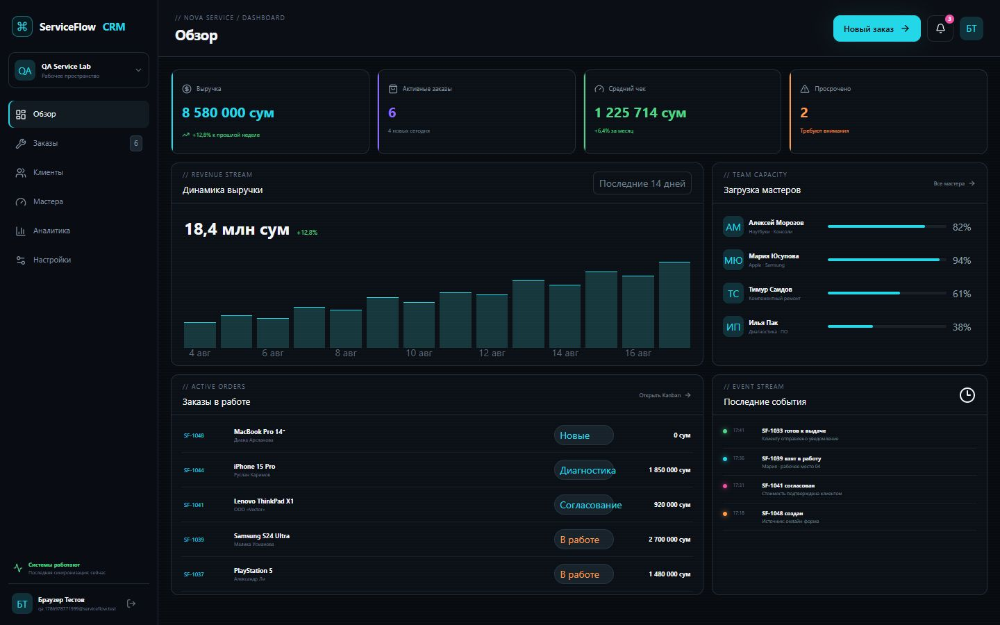

# ServiceFlow CRM

Интерактивный SaaS-концепт CRM для сервисного центра. Проект демонстрирует продуктовые сценарии, адаптивный интерфейс и взаимодействие с демонстрационными данными.

**Статус:** интерактивный SaaS-концепт для портфолио. Авторизация и данные работают в demo-режиме с локальным хранением в браузере.

[Открыть живое демо](https://serviceflow-crm.atumovichatuma.chatgpt.site)



## Возможности концепта

- dashboard с ключевыми показателями и загрузкой команды;
- Kanban заказов с drag-and-drop, поиском и фильтрами;
- карточки клиентов, устройств и истории обращений;
- сотрудники, назначения исполнителей и аналитика;
- demo-регистрация, вход и восстановление доступа;
- адаптивные сценарии для компьютера и телефона.

Все записи демонстрационные. Demo-auth и браузерное хранение показывают UX продукта; подключение серверной авторизации, общей базы и production-эксплуатация требуют отдельной реализации.

## Стек

React 19 · TypeScript · vinext · Cloudflare Workers · Lucide React.

## Локальный запуск

Требуется Node.js 22.13 или новее.

```bash
npm ci
npm run dev
```

Для запуска текущего демо внешние API-ключи не требуются. Рабочие секреты нельзя добавлять в клиентский код или Git.

## Проверки

```bash
npm run lint
npm test
```

`npm test` собирает проект и запускает существующие проверки серверного рендера и продуктовых сценариев. Отдельная production-сборка: `npm run build`.

## Структура

- `app/` — страницы продукта;
- `components/crm-shell.tsx` — оболочка CRM;
- `lib/` — demo-auth и локальные данные;
- `tests/` — проверки рендера;
- [docs/hosting.md](docs/hosting.md) — технические сведения о платформе хостинга;
- [CONTRIBUTING.md](CONTRIBUTING.md) — ветки, CI и безопасность.
